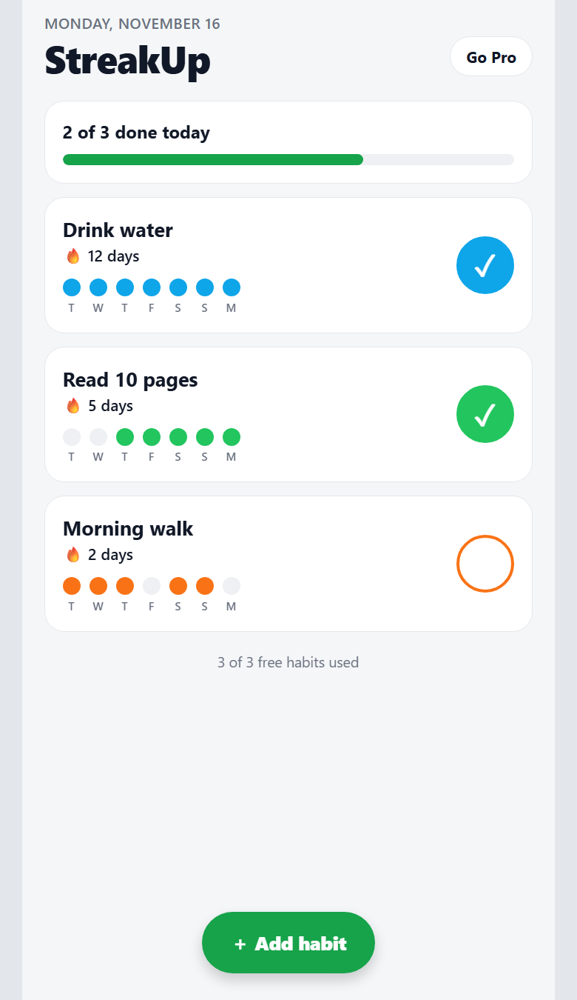
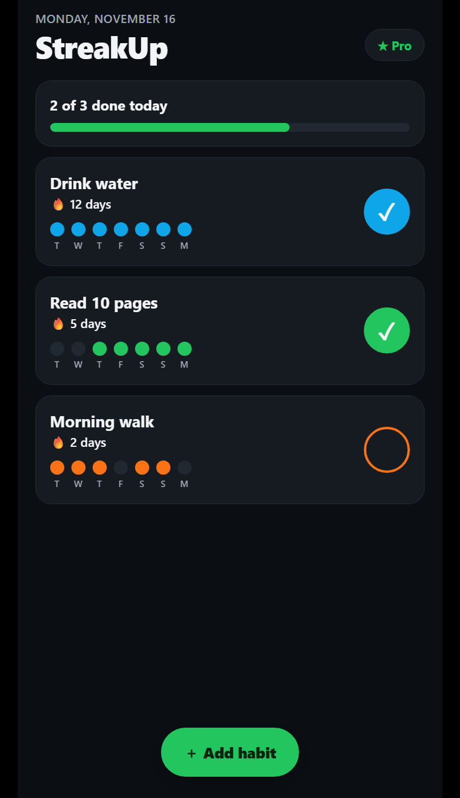

<div align="center">

# 🔥 StreakUp

### The habit tracker that does one thing well: one tap a day, and a streak you won't want to break.

[](https://tirth1263.github.io/StreakUp-Habit-Tracker/)


<br />


&nbsp;&nbsp;


</div>

---

## 👋 What is StreakUp?

You add a habit like **“drink water”** or **“read 10 pages”**. Each day you tap a checkmark.
StreakUp shows how many days in a row you've kept it up, paints your month on a calendar, and nudges
you with a reminder at the time you choose.

That's the whole app. No feeds, no accounts, no sign-up wall. Open it, tap, close it.

**👉 [Try the live demo in your browser](https://tirth1263.github.io/StreakUp-Habit-Tracker/)** — nothing to install.

## ✨ Features

| | |
|---|---|
| ✅ **One-tap check-ins** | Mark today done from the home screen. Tap again to undo. |
| 🔥 **Streak counter** | Current streak, best-ever streak and total check-ins for every habit. |
| 📅 **Calendar grid** | A month view where every completed day is filled in. Tap a past day to fix a mistake. |
| 🔔 **Daily reminders** | Pick a time per habit. The phone sends the reminder itself, with no internet needed. |
| 📴 **Works offline** | Everything is saved on your device. It works on a plane, in a tunnel, anywhere. |
| 🔒 **Private by design** | No login, no server, no analytics. Your habits never leave your phone. |
| 🎉 **Confetti** | Finish every habit for the day and the screen celebrates with you. |
| 🌙 **Dark mode** *(Pro)* | A calm dark theme for late-night check-ins. |

## 🧠 How it works (in plain words)

- **Your data lives on your phone.** Habits and check-ins are stored in a small local database
  ([Expo SQLite](https://docs.expo.dev/versions/latest/sdk/sqlite/)). There is no backend at all,
  which means **no running costs** and **no privacy headaches**.
- **Two tables are all it takes:**

  | Table | What it holds |
  |---|---|
  | `habits` | name, colour, reminder time |
  | `checkins` | habit id + the date it was done |

- **The streak rule:** start at today and count backwards while each day has a check-in.
  One kind detail: if you haven't checked in *yet* today, yesterday's streak still shows — it only
  resets after a full day is missed. The whole rule is about ten lines in
  [`src/lib/streak.ts`](src/lib/streak.ts), with tests beside it.
- **Reminders come from the phone, not the internet**
  ([Expo Notifications](https://docs.expo.dev/versions/latest/sdk/notifications/)), so they fire
  even in airplane mode.

## 💎 Free vs Pro

StreakUp is free to use. **Pro is a one-time unlock — no subscription.**

| | Free | Pro |
|---|:---:|:---:|
| Habits | 3 | Unlimited |
| Streaks, calendar, reminders | ✅ | ✅ |
| Dark mode | — | ✅ |
| Home-screen widget *(planned)* | — | ✅ |

Purchases are handled by [RevenueCat](https://www.revenuecat.com/). Until you add your own store
keys the app runs in **demo mode**, where “Unlock Pro” is free and nothing is charged — handy for
trying every feature. The website always runs in demo mode.

## 🚀 Run it yourself

You need [Node.js](https://nodejs.org/) 20 or newer.

```bash
git clone https://github.com/tirth1263/StreakUp-Habit-Tracker.git
cd StreakUp-Habit-Tracker
npm install
npm start
```

Then either:

- **On your phone:** install **Expo Go** from the App Store / Play Store and scan the QR code, or
- **In your browser:** press `w` in the terminal.

Other handy commands:

```bash
npm test            # run the streak logic tests
npm run typecheck   # check types
npm run build:web   # build the website into dist/
```

## 🗂️ Project structure

```
App.tsx                    Navigation and app shell
src/
├── screens/
│   ├── HomeScreen         List of habits with checkmarks
│   ├── HabitFormScreen    Add / edit / delete a habit
│   ├── HabitDetailsScreen Calendar + streak stats
│   └── SettingsScreen     Pro unlock and dark mode
├── components/            CalendarGrid, Confetti
├── lib/streak.ts          Date keys + streak maths (unit-tested)
├── data/
│   ├── storage.ts         SQLite storage for iOS and Android
│   └── storage.web.ts     Browser storage for the website
├── services/
│   ├── reminders.ts       Daily local notifications
│   └── purchases.ts       RevenueCat (Pro unlock)
├── store.tsx              App state shared by every screen
└── theme.ts               Colours for light and dark mode
```

Files ending in `.web.ts` are picked automatically for the website. That's how one codebase uses
SQLite on phones and browser storage on the web without any `if (web)` checks in the screens.

## 🛠️ Tech stack

- **[Expo](https://expo.dev/) + React Native + TypeScript** — one codebase for iOS, Android and web
- **Expo SQLite** — on-device database
- **Expo Notifications** — local daily reminders
- **React Navigation** — screen-to-screen navigation
- **RevenueCat** — in-app purchase for Pro
- **GitHub Actions + GitHub Pages** — every push to `main` tests, builds and publishes the website

## 📦 Shipping to the app stores

1. **Set up Pro (optional).** Create a one-time product in App Store Connect / Google Play Console,
   attach it to an entitlement named `pro` in RevenueCat, then copy `.env.example` to `.env` and
   paste your public SDK keys.
2. **Build with EAS:**
   ```bash
   npm install -g eas-cli
   eas login
   eas build --platform android   # or ios
   ```
3. **Submit:** `eas submit --platform android` (or `ios`).

Build profiles live in [`eas.json`](eas.json).

## 🧭 Roadmap

- [ ] Home-screen widget
- [ ] Skip days (e.g. weekdays-only habits)
- [ ] Backup and restore to a file
- [ ] More themes

## 🤝 Contributing

Ideas, bug reports and pull requests are welcome. Open an
[issue](https://github.com/tirth1263/StreakUp-Habit-Tracker/issues) to start a conversation.

## 📄 License

[MIT](LICENSE) — free to use, learn from and build on.

<div align="center">

**If StreakUp helped you build a routine, a ⭐ on this repo means a lot.**

</div>
